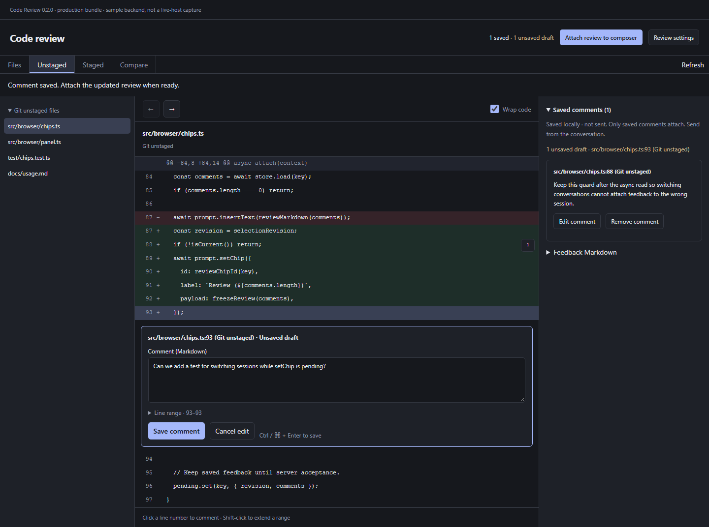

# Code Review for PI WEB

A standalone Review tab for workspace files, staged/unstaged Git changes, and accumulated branch/commit comparisons. Save line-range comments, then attach a removable review chip to the selected conversation. No host patches or prompt-text insertion are required.

## Requirements and installation

Version **0.2.0** requires **PI WEB >=1.202610.6**, Node.js **>=22.19.0**, and Git for staged/unstaged and revision-comparison review. Tested against PI WEB `1.202610.6`; later releases have not been independently verified.

Install `npm:@compn3rd/pi-web-code-review` through **Settings → Pi packages** on the target machine, then enable **Code Review** in **Settings → PI WEB plugins**. For local builds and manual installation, see the [usage guide](docs/usage.md).

This package includes a server plugin: restart the target session daemon when safe, then reload the browser. Restarting interrupts active sessions and terminals; do it from outside the sessions that daemon hosts. Install the package on each remote machine where you want to review files.

## Two review layouts

Open **Review settings** in the panel header to choose:

- **Workbench** — persistent file navigation, code viewer, and saved-feedback rail on wide panels. On phones, files and notes open in sheets.
- **Focus** — a wide code view with inline feedback, a file switcher, and a collapsible saved-review summary.

The layout and **Wrap code** preference are saved for this browser, across workspaces. Switching layouts preserves the current file, line range, and unsaved draft. Unsaved drafts are not persisted across browser reloads or workspace changes.

[Focus layout](docs/screenshots/0.2.0/focus-desktop.png) · [Phone Workbench](docs/screenshots/0.2.0/workbench-phone.png) · [Phone Focus](docs/screenshots/0.2.0/focus-phone.png) · [Phone settings](docs/screenshots/0.2.0/phone-settings.png)

Screenshots render the production bundle with sample backend data, not a live PI WEB host. Phone captures use Chromium at phone viewport sizes, not real devices.

## Review workflow

Choose **Files**, **Unstaged**, **Staged**, or **Compare**. Compare `main...HEAD` for branch work since its merge base, or `HEAD~3..HEAD` for accumulated work between commits. Comparison comments retain frozen commit IDs.

Click or tap a line number to open an inline comment editor. Shift-click extends the range; on phones, expand **Line range** to edit the coordinates. Save your comments, select a ready conversation, and choose **Attach review to composer**. This stages a removable **Review (N)** chip; it does not send a message or include unsaved drafts. Removing the chip preserves saved comments. Server acceptance clears only unchanged submitted comments.

## Validation

Typechecking, lint, **99 tests**, builds, and unpacked/packed artifact smoke checks pass. Production-bundle Chromium checks cover dark/light palettes, phone widths **360/390/430px**, wrapping, settings, draft preservation, sheets, keyboard modality, range editing and mocked composer attachment. `npm audit` reports no known vulnerabilities in the resolved dependency tree.

Live-host shared styling, real phone keyboards, remote-machine behavior and end-to-end send acceptance remain follow-up validation; they are not claimed as completed.

See the [usage guide](docs/usage.md), [development guide](docs/development.md), [compatibility results](docs/compatibility.md), and [composer design](docs/composer-design.md).

Adapted from the Code Review UI branch and PI WEB's MIT-licensed plugin examples; see [LICENSE](LICENSE).

## Community discovery

This package declares `piWeb.plugins` and the `pi-web.dev-plugin`, `pi-package`,
and `pi-web-plugin` npm keywords required by the
[PI WEB community directory](https://pi-web.dev/community-plugins). No separate
registration or submission is needed. Discovery requires publishing a new public
npm version containing this metadata; npm search indexing may take time. Source
changes alone do not update the directory. The compatibility and installation
requirements above still apply.
